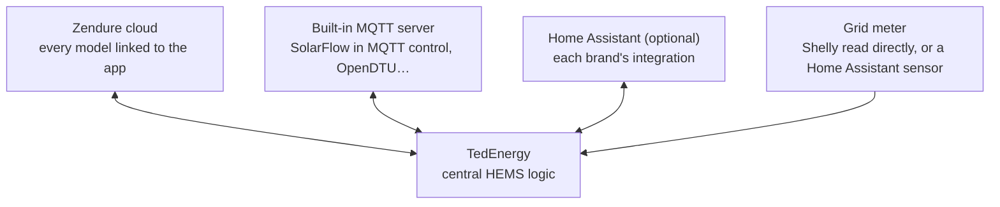

# TedEnergy — multi-brand HEMS for solar batteries

*Formerly named TED Energy Controller.*

**Control all your solar inverters and home batteries, whatever their brand, as one
virtual battery — locally, with or without Home Assistant.**

[Version française plus bas](#en-français) · Website: <https://ted-energy.fr/en/> ·
Live demo: <https://ted-energy.fr/en/live-demo>

TedEnergy is a home energy management system (HEMS) that runs at home. It reads
your grid meter about every two seconds, computes a single charge or discharge
setpoint and shares it between all your inverters and batteries (Zendure,
Marstek, EcoFlow, Huawei, Victron, Sungrow, Deye…) to keep the grid around your
target, such as zero export, and use your own solar production.

## How it works

TedEnergy provides the central HEMS logic; each device is reached the way that
suits it best.



- **Zendure**: every model linked to the Zendure app (Hyper 2000, SolarFlow
  800 to 2400 Pro, Hub 1200 / 2000, AIO 2400, ACE 1500) through the Zendure cloud,
  with your account — no Home Assistant needed. One connection per Zendure
  account: TedEnergy or Home Assistant's Zendure integration; TedEnergy then
  republishes its values to Home Assistant over MQTT.
- **MQTT**: devices that publish over MQTT (Zendure in local "MQTT control"
  depending on the firmware, OpenDTU, ESPHome, Home Assistant discovery format).
- **Home Assistant**: any brand whose integration exposes a controllable setpoint.
- A device that cannot be controlled is included read-only (monitored).

## Features

- **Virtual battery**: batteries of different brands controlled as one setpoint.
- **Optimised charging**: two inverters stay ready (one charging, one
  discharging), the others stay on standby — on a real day, about nine times
  fewer charge / discharge reversals than a simple equal split.
- **Autonomous mode**: grid power regulated around a target, for example 0 W
  (zero export), single or different depending on the time of year.
- **Assisted mode**: one manufacturer's HEMS keeps control of its devices,
  TedEnergy adds the other batteries as reinforcement.
- **Free-form automations** (nested AND / OR rules on any value, battery limits,
  Home Assistant actions, webhooks): water heater on surplus, car charging
  without draining the batteries, weekly full charge, peak shaving…
- **Tariffs**: off-peak hours, Tempo, savings in kWh and €, PDF reports.
- **Appliances** (EV charger, water heater, heat pump, pool) in a live 3D house.
- **Battery care**: per-device limits and levels, calibration, cell voltage gap
  alert; a faulty device is excluded, then retested automatically.
- **Android app** with signed remote access; runs **locally**.

## Install

### Home Assistant OS (simplest)

[](https://my.home-assistant.io/redirect/supervisor_add_addon_repository/?repository_url=https://github.com/LaurentFoulon/ted-home-assistant)

Or add this repository address to the Home Assistant app store (menu **⋮** →
**Repositories**): `https://github.com/LaurentFoulon/ted-home-assistant`, then install **TedEnergy**. Home
Assistant then announces every new version by itself.

### Docker (NAS, mini-PC, Raspberry Pi…)

The same image is published on Docker Hub for Intel/AMD (amd64) and ARM64:

```bash
docker pull tedenergy/ted:latest
```

```bash
docker run -d --name ted-bot --restart unless-stopped -p 5002:5000 -p 1885:1885 -v /path/to/ted:/data tedenergy/ted:latest
```

Port 1885: built-in MQTT server; another machine port such as `-p 1890:1885`
works if 1885 is taken.

Open `http://<machine>:5002`: a setup wizard asks for the license, the meter and
your electricity contract (Home Assistant optional). Synology without the
command line: <https://ted-energy.fr/en/installation/synology>

### Requirements

- An always-on machine (Home Assistant OS, NAS, mini-PC, Raspberry Pi).
- Reachable inverters: Zendure account (cloud), MQTT, or Home Assistant for
  other brands.
- A grid meter reading: a Shelly read directly, or a Home Assistant sensor.

## How it compares

- **Omnibattery** is a Home Assistant integration that talks locally to a list
  of supported batteries (up to 10); it does not control the Zendure Hyper 2000,
  Hub, AIO or ACE (no local API). TedEnergy reaches every Zendure through the
  cloud, works without Home Assistant and can keep a manufacturer HEMS in place.
- **EMHASS** optimises a schedule from forecasts and prices and publishes
  setpoints that your automations apply; TedEnergy regulates in real time and
  shares the power across all batteries itself.
- **Predbat** plans charging around tariffs and forecasts for supported
  inverters; TedEnergy focuses on making devices of different brands work as one.
- **evcc** is first an electric car charging manager.

Full comparison: <https://ted-energy.fr/en/home-assistant-hems-comparison>

## License

TedEnergy is proprietary software (all rights reserved), free to use until
further notice. Its interface is currently in French (English planned).

This repository only contains the Home Assistant app description
(`ted/config.yaml`, documentation, icons, translations). The program itself is
distributed as a compiled Docker image (`tedenergy/ted`), without source code.

## Links

- Compatibility, model by model: <https://ted-energy.fr/en/compatibility>
- Optimised charging, a real day: <https://ted-energy.fr/en/optimised-charging>
- What is a multi-brand HEMS? <https://ted-energy.fr/en/home-assistant-hems>
- Community (Discord): <https://discord.gg/BNy9QkPMkZ>
- Roadmap and votes: <https://ted-energy.fr/en/roadmap>

---

## En français

**TedEnergy (anciennement TED Energy Controller) est un HEMS multimarque pour
batteries solaires** : il pilote ensemble tous vos onduleurs et batteries, quelle
que soit leur marque, comme une seule batterie. Il lit votre compteur environ
toutes les deux secondes, calcule une consigne unique et la répartit entre tous
les appareils pour garder le réseau autour de votre cible (zéro injection).
Home Assistant est facultatif : tous les Zendure (Hyper 2000 compris) se pilotent
par le cloud Zendure, les appareils MQTT par le serveur intégré, et les autres
marques par Home Assistant.

### Installer TedEnergy dans Home Assistant OS

Bouton **Add the TedEnergy repository** ci-dessus, ou à la main :

1. **Paramètres → Applications → Boutique** → menu **⋮** → **Dépôts**.
2. Ajoutez l'adresse : `https://github.com/LaurentFoulon/ted-home-assistant`
3. Installez **TedEnergy**, puis suivez l'onglet **Documentation**.

Home Assistant signale ensuite automatiquement chaque nouvelle version.

### Docker (NAS, mini-PC, Raspberry Pi…)

Image Docker Hub `tedenergy/ted` (Intel/AMD et ARM64), commandes ci-dessus. Guide :
<https://ted-energy.fr/installation>

### Pour aller plus loin

- Compatibilité, modèle par modèle : <https://ted-energy.fr/compatibilite>
- La charge optimisée sur une vraie journée : <https://ted-energy.fr/charge-optimisee>
- Comparatif (Omnibattery, EMHASS, Predbat, evcc) :
  <https://ted-energy.fr/comparatif-hems-home-assistant>
- Communauté Discord : <https://discord.gg/BNy9QkPMkZ>

TedEnergy est un logiciel propriétaire gratuit jusqu'à nouvel ordre (tous droits
réservés) ; ce dépôt ne contient que la description de l'application pour Home
Assistant, sans code source.
